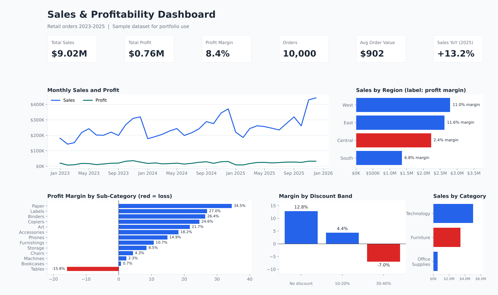

# Sales & Profitability Analytics Dashboard (Power BI)

An end-to-end analytics project: raw retail orders are cleaned in Power Query, modelled as a star schema, analysed with DAX, and presented in an interactive Power BI dashboard that answers a clear business question.



## Business Problem

A retail business has growing sales but a thin profit margin. Which regions, categories and discount levels are quietly destroying profit, and where should management act first?

## Dataset

- `data/sales_data_raw.csv`: 10,100 order lines (2023-2025) with 100 duplicate rows and 60 missing `Ship Mode` values, as received.
- `data/sales_data_clean.csv`: 10,000 order lines after cleaning.
- Columns: Order ID, Order Date, Ship Date, Ship Mode, Customer ID, Segment, Region, State, Category, Sub-Category, Product Name, Quantity, Discount, Sales, Profit.

> **Note:** this is a synthetic sample dataset generated for portfolio practice, modelled on typical retail sales data. The figures below describe this dataset, not a real company.

## Tools

Power BI Desktop, DAX, Power Query, SQL (optional extraction step), Excel, Python (data generation and the preview image).

## Process

1. **Clean (Power Query):** removed 100 duplicate rows, replaced 60 null Ship Mode values with "Unknown", set data types, converted dates.
2. **Model:** star schema with a `Sales` fact table and `Date`, `Product`, `Customer` and `Region` dimensions, joined with one-to-many relationships.
3. **Measure (DAX):** Total Sales, Total Profit, Profit Margin %, Orders, Average Order Value, YoY Growth and more. See [`dax_measures.md`](dax_measures.md).
4. **Visualise:** KPI cards, monthly trend, regional comparison, sub-category margin, discount analysis, with slicers for Year, Region, Category and Segment.
5. **Interpret:** turned the visuals into recommendations.

## Key Insights

| Metric | Value |
|---|---|
| Total Sales | $9.02M |
| Total Profit | $0.76M |
| Profit Margin | 8.4% |
| Orders | 10,000 |
| Average Order Value | $902 |
| Sales growth | +12.3% (2024), +13.2% (2025) |

- **Furniture sells a lot but loses money.** It brings in $3.42M in sales at a -4.6% margin. Tables alone run at -15.8%.
- **Heavy discounts erase profit.** Orders with 30-40% discounts have a -7.0% margin, versus 12.8% with no discount.
- **The Central region lags.** Its margin is 2.4%, compared with 11.6% in East and 11.0% in West.
- **Technology and Office Supplies carry profitability.** Technology earns a 16.2% margin on $5.03M of sales; Office Supplies earns 18.1%.
- **Sales are seasonal.** Revenue peaks in November and December every year.

## Recommendations

1. Cap discounts at 20% for Furniture, and review the pricing and sourcing of Tables.
2. Investigate the Central region's cost and discount structure.
3. Shift marketing spend toward high-margin Technology and Office Supplies lines.
4. Plan inventory and promotions around the Q4 peak.

## How to Rebuild the .pbix

1. Open Power BI Desktop, then Get Data, Text/CSV, and load `data/sales_data_raw.csv`.
2. In Power Query: Remove Duplicates, replace null `Ship Mode` with "Unknown", set column types, and close and apply.
3. Create a Date table (see the DAX file) and relate it to `Order Date`.
4. Add the measures from `dax_measures.md`.
5. Build the visuals shown in the image, add slicers, and save as `Sales_Profitability_Dashboard.pbix`.

## Repository Structure

```
powerbi-sales-dashboard/
├── README.md
├── dashboard.png
├── dax_measures.md
└── data/
    ├── sales_data_raw.csv
    └── sales_data_clean.csv
```

## Author

Akshaya Giramgari | [LinkedIn](https://linkedin.com/in/akshayareddy25) | [GitHub](https://github.com/akshayareddy554)
